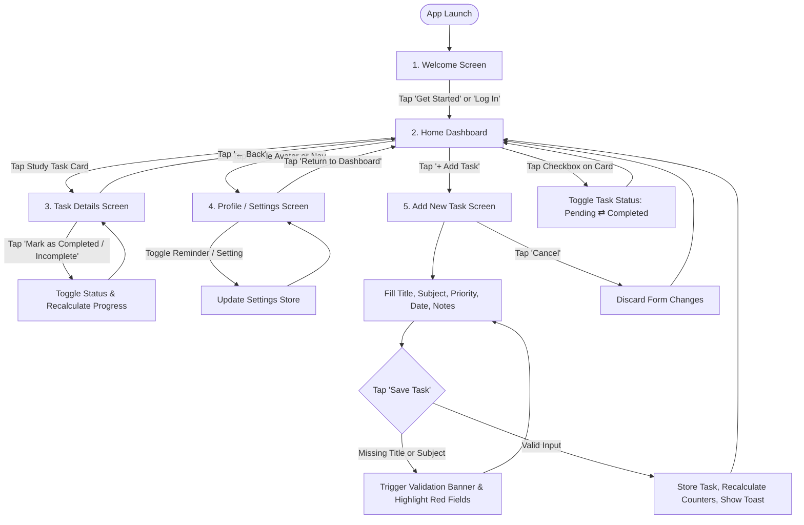

# Study Planner Mobile App — UI/UX Wireframes & Interactive Prototype

> **CodeNova UI/UX Design Internship — Batch 01**  
> **Task 1: Mobile App Wireframes**  
> **Candidate Name:** Kanishka  
> **Project Title:** Study Planner Mobile App  
> **Mobile Reference:** 390 × 844 px (iPhone 14 standard reference frame)  
> **Design Grid:** 8-Point Spacing Grid System  
> **Accessibility Standard:** Minimum 44 × 44 px Touch Targets, WCAG 2.1 AA Contrast  

---

## 📌 Project Overview

The **Study Planner Mobile App** is a beginner-friendly, mobile-first utility designed to help college and university students structure their study schedules, organize course tasks, and stay on top of critical assignment deadlines without experiencing cognitive overload. 

Rather than overwhelming students with unnecessary enterprise project management features, the Study Planner emphasizes **low-friction task capture, transparent deadline tracking, and glanceable daily progress**.

This project contains:
1. **Low-Fidelity & Structural Mobile Wireframes** for 5 core screens.
2. **An Interactive Browser-Based Mobile Prototype** built using clean HTML5, CSS3, and modern JavaScript (no external paid APIs, libraries, or subscriptions required).
3. **An Integrated Presentation Artboard Mode** allowing reviewers to inspect all 5 screens side-by-side with wireframe annotations and export them directly to PDF or high-resolution PNGs.
4. **An Interactive 8-Point Grid Overlay Tool** built into the prototype to verify spacing adherence in real time.
5. **Complete UI/UX Documentation**, including user persona, problem statement, user flows, design decisions, and recreation steps for Figma and Penpot.

---

## 👤 User Persona

| Attribute | Details |
| :--- | :--- |
| **Persona Name** | Kanishka |
| **Age / Role** | 20 years old • 2nd-year Undergraduate Computer Science Student |
| **Daily Routine** | Balances 5 lecture courses, bi-weekly coding labs, team projects, and part-time campus tutoring. |
| **Tech Habits** | Uses a smartphone for everything; checks phone between lectures, while commuting, and late at night. |
| **Core Goals** | • Quickly log homework and project deadlines right after lecture.<br>• See exactly what is due today and this week at a single glance.<br>• Avoid missed deadlines and last-minute cramming through clear priority tags. |
| **Key Frustrations** | • Generic calendar and productivity apps are bloated, require too many clicks, and feel like corporate spreadsheets.<br>• Difficulty prioritizing tasks when multiple assignments from different subjects collide.<br>• Cluttered interfaces with distracting visual noise that increase academic anxiety. |

---

## 🎯 User Problem Statement

Modern university students juggle multiple courses with conflicting assignment formats, irregular deadlines, and separate learning management platforms. Generic productivity tools frequently fail students because:
1. **High Capture Friction:** Adding an assignment takes too many clicks and complex configurations (workspaces, tags, custom fields).
2. **Lack of Glanceability:** Dashboards fail to immediately communicate what requires immediate action today versus later in the week.
3. **Absence of Focus:** Feature-heavy applications cause visual distraction rather than helping the student focus on the task at hand.

**Design Objective:** Create a clean, low-fidelity, mobile-first wireframe foundation that enables students to log an assignment in under 15 seconds, assess daily priorities in under 3 seconds, and mark work completed with clear positive reinforcement.

---

## 📱 Detailed Screen Wireframe Specifications

The prototype includes all **4 mandatory screens** plus the **recommended 5th screen** (Add New Task with Validation):

```
┌─────────────────┐   ┌─────────────────┐   ┌─────────────────┐   ┌─────────────────┐   ┌─────────────────┐
│   SCREEN 01     │   │   SCREEN 02     │   │   SCREEN 03     │   │   SCREEN 04     │   │   SCREEN 05     │
│   Welcome &     │──►│      Home       │──►│      Task       │   │    Profile &    │   │     Add New     │
│   Onboarding    │   │    Dashboard    │   │     Details     │   │    Settings     │   │ Task (Validated)│
└─────────────────┘   └─────────────────┘   └─────────────────┘   └─────────────────┘   └─────────────────┘
```

### Screen 1: Welcome / Onboarding Screen
* **Purpose:** Introduces new students to the app's value proposition and establishes trust through minimalist, focused design.
* **Key Components:**
  * App title (*Study Planner*) with category badge.
  * Wireframe placeholder illustration box representing study materials.
  * Concise value proposition list highlighting deadline organization and reminders.
  * Primary Call to Action (CTA): `Get Started` button ($\ge 48\text{ px}$ height).
  * Secondary login link: *"Already have an account? Log In"*.
* **Navigation Path:** Tapping `Get Started` or `Log In` smoothly transitions into the **Home Dashboard**.

### Screen 2: Home Dashboard
* **Purpose:** The student's primary command center. Provides an instant overview of daily progress and upcoming course deadlines.
* **Key Components:**
  * Greeting header (*"Hello, Kanishka 👋"*) with the active date and profile shortcut avatar.
  * **Today's Progress Card:** Dynamic progress bar showing percent completed, alongside numerical counters for **Pending Tasks** and **Completed Tasks**.
  * **Task Filtering Segmented Tabs:** Filter tasks between *All*, *Pending*, and *Completed*.
  * **Study Task Cards:** Clean cards showing Course Pill (*e.g., CS201 Computer Science*), Task Title, Due Date with calendar icon, Priority Tag (*HIGH, MEDIUM, LOW*), and accessible touch checkbox ($44 \times 44\text{ px}$).
  * **Empty State:** Illustrated container displayed when a filter returns zero tasks.
  * **Prominent Floating Action:** `+ Add Study Task` button positioned for natural thumb reach.
  * **Bottom Navigation Bar:** Three-item fixed navigation (*Home [Active]*, *New Task*, *Profile*).

### Screen 3: Task Details Screen
* **Purpose:** Displays in-depth information for an individual study assignment, allowing the student to inspect notes, check subtasks, or toggle completion.
* **Key Components:**
  * Top navigation bar with accessible `← Back` touch target ($44 \times 44\text{ px}$) returning to the Dashboard.
  * **Status Badge:** Visual indicator distinguishing *Pending* vs. *Completed* status.
  * **Task Title & Meta Grid:** 2-column layout showcasing Subject, Priority tag, Due Date/Time, and Estimated Study Duration.
  * **Notes / Assignment Prompt Card:** Dedicated container displaying reading requirements, rubrics, or professor reminders.
  * **Interactive Subtask Checklist:** Step-by-step checklist items allowing students to break larger assignments into manageable milestones.
  * **Primary Action Button:** `Mark as Completed` / `Mark as Incomplete` state-switching button.

### Screen 4: Profile / Settings Screen
* **Purpose:** Enables the student to configure study reminder notifications, personalize app preferences, and inspect study consistency.
* **Key Components:**
  * Student Profile Card: Avatar initials placeholder, Name (*Kanishka*), Academic Program (*Computer Science, Year 2*), and Study Streak Badge (*🔥 5 Day Study Streak*).
  * **Reminder Preferences Section:** Toggle switches for *Daily Morning Digest (8:00 AM)*, *Deadline Alerts (2 hours prior)*, and *Vibration/Haptic Feedback*.
  * **App Settings Section:** Toggles for *High-Contrast Wireframe Mode*, *Default Study Session Duration (Pomodoro)*, and *Start of Week*.
  * **Data & Demo Management:** Reset button to restore initial sample courses and tasks.
  * `Return to Dashboard` navigation button ensuring zero dead ends.

### Screen 5: Add New Task Screen (Recommended 5th Screen)
* **Purpose:** A focused, distraction-free modal screen for quick assignment entry equipped with robust validation.
* **Key Components:**
  * Header bar with `Cancel` (or `✕`) and top `Save` action.
  * **Task Title Input:** Text field with character counter (`0/60`), required asterisk (`*`), and clear placeholder text.
  * **Course / Subject Dropdown:** Select menu populated with active academic subjects.
  * **Priority Selector Chips:** Accessible segment controls for *LOW*, *MEDIUM*, and *HIGH* priority (all $\ge 44\text{ px}$ tap targets).
  * **Due Date & Time Picker:** HTML5 datetime control ensuring accurate deadline scheduling.
  * **Study Notes Textarea:** Multi-line text field for syllabus excerpts or assignment prompts.
  * **Active Validation Error Alert:** Visible error banner and highlighted red input fields if the user attempts to submit without a title or subject.
  * Dual Action Footer: `Cancel` (discards input) and `Save Task` (validates and commits).

---

## 🔀 User-Flow Diagram

Below is the user flow diagram illustrating screen transitions, validation gates, and decision loops:



> For full textual breakdowns of triggers, decision points, and UI feedback for each step, see [USER_FLOW.md](USER_FLOW.md).

---

## 📐 Design Decisions & Accessibility Considerations

### 1. 8-Point Spacing Grid
The entire visual layout adheres to a strict **8-point spatial system** (`8px`, `16px`, `24px`, `32px`, `40px`, `48px`). Half-grid units (`4px`) are reserved exclusively for compact micro-alignments such as chip padding and icon offsets. This guarantees mathematical rhythm, visual predictability, and consistent component proportions across every screen.

### 2. Touch Target Compliance ($\ge 44 \times 44\text{ px}$)
In accordance with **Apple Human Interface Guidelines** and **WCAG 2.5.5 (Target Size)**:
- All primary buttons (`btn-primary`, `btn-secondary`) have a minimum height of $48\text{ px}$.
- Checkboxes feature an invisible bounding target of $44 \times 44\text{ px}$ to eliminate mis-taps.
- Bottom navigation icons, header navigation buttons (`← Back`), and priority selector chips are styled with minimum dimensions of $44 \times 44\text{ px}$.

### 3. Visual Hierarchy & Grayscale Wireframing
- **Structure First:** To prevent premature visual decoration from obscuring layout usability, the app uses a clean grayscale wireframe palette (`#111827`, `#4B5563`, `#6B7280`, `#E5E7EB`, `#FAFAFA`).
- **Purposeful Color:** Restrained, functional accents are used strictly to communicate status:
  - Accessible Blue (`#2563EB`) for interactive links and focus states.
  - Accessible Red (`#DC2626`) for form validation errors and high priority alerts.
  - Soft Neutral Green (`#15803D`) for completed progress indicators.
- **Typographic Scale:** Built on system sans-serif fonts (`-apple-system`, `BlinkMacSystemFont`, `Segoe UI`, `Roboto`) with strong contrast between section headings ($20\text{–}24\text{ px}$, bold), body text ($15\text{–}16\text{ px}$), and metadata captions ($12\text{–}13\text{ px}$).

### 4. Accessibility & Cognitive Inclusivity
- **WCAG 2.1 AA Contrast:** All text elements exceed the $4.5:1$ contrast ratio against their respective card backgrounds.
- **Semantic HTML & ARIA:** Built with semantic tags (`<header>`, `<main>`, `<article>`, `<nav>`, `<button>`), `aria-label` descriptors, and `role="alert"` for form validation.
- **Predictable Navigation:** Every sub-screen provides an explicit back navigation button. There are zero dead-end user flows.

---

## 🛠️ Tools Used

- **HTML5:** Semantic markup, form controls, and accessible screen structure.
- **CSS3:** CSS Custom Properties (Design Tokens), 8-point grid variables, flexbox, CSS grid, and responsive print/export stylesheets.
- **JavaScript (ES6):** State controller, screen routing, client-side form validation, local storage persistence, and interactive artboard cloning.
- **Mermaid.js / Markdown:** User flow mapping and documentation.
- **No paid APIs, subscriptions, or backend servers are required.**

---

## 💻 How to Run & Preview the Local Prototype

You can run and test this project locally using any modern web browser (Google Chrome, Mozilla Firefox, Microsoft Edge, or Safari).

### Method A: Direct Browser Launch (Simplest)
1. Navigate to the project directory on your computer:
   ```
   c:\Users\KANISHKA\Documents\task1
   ```
2. Double-click the `index.html` file (or right-click $\to$ **Open with** $\to$ **Google Chrome**).
3. The interactive wireframe prototype will immediately launch in your browser.

### Method B: Lightweight Local HTTP Server
If you prefer running a local development server:
```powershell
# Open PowerShell in the project directory
cd c:\Users\KANISHKA\Documents\task1

# Using Python (if installed)
python -m http.server 8080

# Or using Node.js npx
npx serve .
```
Then open `http://localhost:8080` in your browser.

---

## 🖨️ How to Export High-Resolution PNGs or PDF Wireframes

The project includes built-in export features to generate presentation-ready wireframe sheets for your internship submission:

### Option 1: One-Click Export to PDF (Built-in)
1. Open `index.html` in your browser.
2. Click the **"Export / Print Wireframes"** button in the top master toolbar (or press `Ctrl + P` / `Cmd + P`).
3. The app automatically activates the **Artboard Presentation View** and applies print-optimized CSS:
   - Sets destination to **"Save as PDF"**.
   - Set Layout to **Landscape** (or Portrait).
   - Check **"Background graphics"** under more settings.
4. Click **Save** to generate an export-ready, high-resolution multi-screen wireframe PDF!

### Option 2: Export High-Resolution PNG Screenshots
1. In the top toolbar, switch the view toggle from **"Simulator"** to **"All Screens (Artboard)"**.
2. All 5 mobile screens will be rendered side-by-side with wireframe specification badges.
3. Use your system screenshot utility:
   - **Windows:** Press `Windows Key + Shift + S`, select the screen card, and save as PNG.
   - **Mac:** Press `Cmd + Shift + 4`, drag over the wireframe card, and save.
   - **Chrome DevTools:** Press `F12` $\to$ `Ctrl + Shift + P` $\to$ Type *"Capture full size screenshot"* or *"Capture node screenshot"*.

---

## 🎨 Guide: How to Recreate or Import into Figma or Penpot

If you wish to duplicate or recreate these wireframes in **Figma** (or the free open-source alternative **Penpot**), follow these exact UI/UX specifications:

> [!NOTE]
> This repository provides an interactive HTML/CSS/JS wireframe prototype. A web prototype is not a native `.fig` file; however, you can quickly recreate these exact screens in Figma or Penpot using the design tokens below.

### Step 1: Create the Mobile Artboards
- Create 5 artboards/frames with dimensions: **Width: 390 px, Height: 844 px** (iPhone 14 preset).
- Set background fill to `#FAFAFA` (App canvas).

### Step 2: Configure Layout Grids
- In Figma/Penpot, select the frame $\to$ Add **Layout Grid**:
  - Grid: `8 px` spacing (color: `#2563EB`, opacity: `8%`).
  - Columns: `4 columns`, Margin: `16 px`, Gutter: `16 px`.

### Step 3: Typography Hierarchy
- Set font family to **Inter**, **SF Pro Text**, or **Roboto**:
  - **Screen Titles (H1):** `24 px`, Semi-Bold / Bold, Line Height `32 px`.
  - **Section Headings (H2):** `18 px`, Bold, Line Height `24 px`.
  - **Card Titles / Button Text:** `15 px`, Semi-Bold, Line Height `20 px`.
  - **Body / Notes Text:** `14 px`, Regular, Line Height `20 px`.
  - **Captions / Badges:** `11–12 px`, Medium / Bold, Line Height `16 px`.

### Step 4: Component Auto-Layout & Spacing
- **Task Cards:**
  - Auto-layout: Vertical or Horizontal, Padding: `16 px` internal, Spacing between items: `8 px`.
  - Stroke: `1 px` solid `#D1D5DB`, Corner Radius: `12 px`, Fill: `#FFFFFF`.
- **Primary Buttons:**
  - Auto-layout: Horizontal, Padding: `14 px 24 px` (Minimum height: `48 px`).
  - Fill: `#1F2937` (Dark Charcoal), Text: `#FFFFFF`, Corner Radius: `12 px`.
- **Form Inputs:**
  - Height: `48 px`, Padding: `12 px 16 px`, Stroke: `1.5 px` solid `#D1D5DB`, Corner Radius: `8 px`.
- **Touch Target Verification:** Ensure every interactive component bounding box is at least $44 \times 44\text{ px}$.

---

## 📦 GitHub Submission Preparation Checklist

When preparing your repository for the CodeNova Task 1 submission:

- [x] **Project Directory Cleanliness:** Separate files into `index.html`, `css/style.css`, and `js/app.js`.
- [x] **Screens Implemented:** All 5 wireframes designed and navigable (Welcome, Dashboard, Task Details, Profile/Settings, Add Task).
- [x] **Interactive Functionality:**
  - [x] Navigation flows work smoothly without broken links or dead ends.
  - [x] Task completion can be toggled from both Dashboard and Task Details.
  - [x] Add Task form features active validation with clear inline error messaging.
  - [x] Progress counters update dynamically.
  - [x] Filter tabs switch between All, Pending, and Completed states.
- [x] **Design Standards:** 390 × 844 px mobile reference, 8-point spacing grid, and $\ge 44\text{ px}$ touch targets enforced.
- [x] **Export Tools:** PDF and high-res artboard export capability built in.
- [x] **Documentation Complete:** User persona, problem statement, user flows, and Figma instructions documented in `README.md` and `USER_FLOW.md`.

### Manual Submission Links to Add:
Before submitting to the CodeNova portal, remember to update the placeholders below:
- **GitHub Repository URL:** `https://github.com/[your-username]/codenova-task1-studyplanner`
- **Live Demo Link (GitHub Pages):** `https://[your-username].github.io/codenova-task1-studyplanner/`
- **Figma / Penpot Public Link (View-Only):** `[Paste your view-only Figma/Penpot link here if created]`

---

## 📄 License
This project is prepared exclusively as an educational submission for the **CodeNova UI/UX Design Internship (Batch 01)**. Feel free to reference and learn from this codebase.
